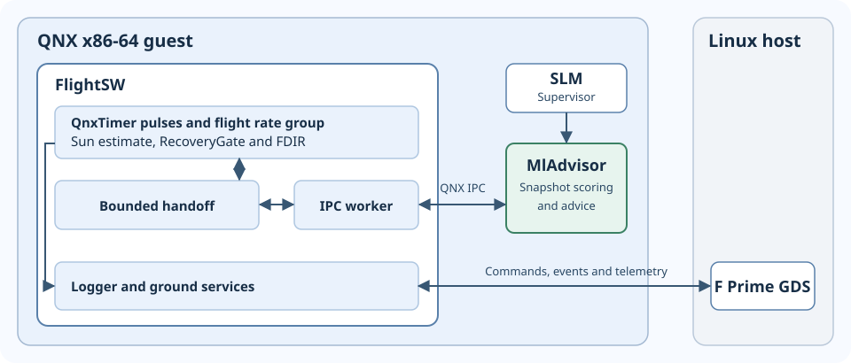

# F Prime on QNX

F Prime on QNX ports NASA/JPL's flight software framework to QNX 8.0 as a reusable
platform library. Upstream Ref exchanges commands, events and telemetry with F Prime
GDS. In a simulated attitude determination and control system (ADCS), native QNX IPC
and supervised restart exercise fault detection, isolation and recovery (FDIR)
and the return of a separate onboard machine learning advisor.

[For judges](#for-judges) · [Demo](#see-it-work) · [QNX Evidence Index](docs/en/evidence-index.md) ·
[Reproduce](docs/en/reproduce.md) · [Adopt](docs/en/adopt.md) · [Limitations](#limitations)

## At a glance

| Item | Details |
| --- | --- |
| Category | Open-Source Contribution & Ports. [QNX Global Hackathon rules](https://qnx.devpost.com/rules) |
| Upstream | Standalone port with [`nasa/fprime` v4.4.2](https://github.com/nasa/fprime/tree/f22ce8f2f2943e641d454e9daa7f129e6c878d32) as a submodule at `f22ce8f2f2943e641d454e9daa7f129e6c878d32`. |
| Upstream contribution | Posted to `nasa/fprime` on 2026-11-24: [platform discussion #6436](https://github.com/nasa/fprime/discussions/6436) and [POSIX UART issue #6437](https://github.com/nasa/fprime/issues/6437). No upstream pull request yet. [Status](docs/en/upstream.md) |
| QNX target | QNX SDP 8.0.6 and QNX 8.0.0 x86-64 on QEMU/KVM under Ubuntu 24.04 and WSL2. [Coverage](docs/en/evidence-index.md#target-and-host-coverage) |
| Frozen target source | [`029fadceb532034c91905a6e10007f61ccc9f8d7`](https://github.com/D1349375/fprime-qnx/commit/029fadceb532034c91905a6e10007f61ccc9f8d7). [Evidence index](docs/en/evidence-index.md) |
| Toolchain | `qcc` GCC 12.2.0, CMake and `fprime-util`. [Host setup](docs/en/host-setup.md) |
| License | [Apache-2.0](LICENSE) |
| CI | [](https://github.com/D1349375/fprime-qnx/actions/workflows/host-checks.yml) Host checks only. |

## Why

Flight software teams that already use F Prime need a starting point for bringing
an existing deployment to a QNX target. NASA's separate cFS project has QNX
multi-target build work in progress. QNX is absent from F Prime's published supported
and planned platform lists. [NASA cFS QNX build work](https://github.com/nasa/cFS/pull/1114) ·
[F Prime supported platforms](https://fprime.jpl.nasa.gov/latest/docs/user-manual/framework/supported-platforms/)

FlightSW has to produce an estimate even when an advisor is busy or unavailable.
The reference deployment uses QNX timer pulses for periodic work, native request/reply
between the processes and SLM to supervise the advisor. A bounded handoff keeps
IPC off the periodic flight path and FlightSW controls which advice it uses.
[Architecture](docs/en/architecture.md) · [Evidence of QNX use](#evidence-of-qnx-use)

## What's in the box

| Part | What it provides |
| --- | --- |
| [FprimeQnx](FprimeQnx) | x86-64 toolchain, QNX platform selection, a pulse-driven rate-group timer, a native message driver and an advisor process monitor. |
| [Ref adoption](adoption/ref-qnx.patch) | An upstream deployment example and a clean QNX build-and-GDS check. |
| [ADCS reference](FprimeQnxReference) | Two F Prime processes, simulated coarse sun sensors, deterministic FDIR and RecoveryGate, and opt-in F Prime GDS. |
| [ML inference](FprimeQnxReference/MlDeployment/Ffn.cpp) | An optional mlpack FFN with frozen weights and an offline replay path. |
| [Evidence tools](docs/en/reproduce.md) | Target runners, case verifiers and an application-behavior summary for the restart experiment. |



## For judges

| Criterion | What to inspect |
| --- | --- |
| Technological implementation | The pinned [timer and IPC source](#evidence-of-qnx-use), [target OSAL results](docs/en/results.md#osal-v1), [fault case verifier](FprimeQnxReference/test/int/check-m3.py) and [host CI scope](docs/en/reproduce.md#sdk-free-host-checks). |
| Design | A clean [Ref command round trip](docs/en/reproduce.md#ref-and-gds-v2-and-v2b), [ADCS ground commands and events](docs/en/reproduce.md#adcs-ground-system), and a [recomputable application-behavior report](docs/en/reproduce.md#m4-paired-repair-policy-check). |
| Potential impact | Reuse the platform in an existing F Prime deployment through the [adoption guide](docs/en/adopt.md) and follow the [upstream status](docs/en/upstream.md) for portability work. |
| Innovation & AI Creativity | A separate learned advisor tests the process and recovery boundary. The [inference check](docs/en/results.md#trained-advisor-and-offline-replay) verifies agreement between Linux and QNX. The [paired harness](docs/en/reproduce.md#m4-paired-repair-policy-check) varies the SLM repair setting with the workload and model fixed. |
| Best use of QNX-specific technologies | Trace the implementation and reproduction check for each [QNX mechanism](docs/en/evidence-index.md#qnx-mechanisms). |

## See it work

Run the [ADCS GDS check](docs/en/reproduce.md#adcs-ground-system) to see the command
acknowledgment and the monitored advisor's `ProcessDied` event. FlightSW takes over
with FDIR, SLM starts a replacement and FlightSW accepts its fresh session.
`ControlSource` shows ML, FDIR and ML in that order. The submission video will be
linked here after recording.

## Evidence of QNX use

| Mechanism | Fixed source | What to check |
| --- | --- | --- |
| Timer and pulses | [QnxTimer](https://github.com/D1349375/fprime-qnx/blob/84e722f0ed0f67eec93860204451d048032af11d/FprimeQnx/Svc/QnxTimer/QnxTimer.cpp#L85-L139) | Ref returns rate group 1 telemetry to GDS. |
| Native message passing | [QnxMsgDriver server and client](https://github.com/D1349375/fprime-qnx/blob/84e722f0ed0f67eec93860204451d048032af11d/FprimeQnx/Drv/QnxMsgDriver/QnxMsgDriver.cpp#L28-L141) | FlightSW and the advisor exchange snapshots and advice in different processes. |
| Disconnect and unblock pulses | [Driver pulse handling](https://github.com/D1349375/fprime-qnx/blob/84e722f0ed0f67eec93860204451d048032af11d/FprimeQnx/Drv/QnxMsgDriver/QnxMsgDriver.cpp#L49-L95) | The held-reply case ties the unblock pulse to the pending receive ID. |
| Process isolation and SLM | [SLM template](https://github.com/D1349375/fprime-qnx/blob/84e722f0ed0f67eec93860204451d048032af11d/FprimeQnxReference/qnx/m3-slm.xml.in#L2-L22) | FlightSW uses FDIR before accepting a result from the replacement session. |
| Process-manager death notification | [QnxProcessMonitor](https://github.com/D1349375/fprime-qnx/blob/029fadceb532034c91905a6e10007f61ccc9f8d7/FprimeQnx/Svc/QnxProcessMonitor/QnxProcessMonitor.cpp#L32-L108) · [Event schema](https://github.com/D1349375/fprime-qnx/blob/029fadceb532034c91905a6e10007f61ccc9f8d7/FprimeQnx/Svc/QnxProcessMonitor/QnxProcessMonitor.fpp#L9-L11) | GDS records one `ProcessDied` for the stopped advisor. |
| FIFO scheduling | [Flight scheduling](https://github.com/D1349375/fprime-qnx/blob/029fadceb532034c91905a6e10007f61ccc9f8d7/FprimeQnxReference/FlightDeployment/Main.cpp#L486-L504) | The ground harness checks the flight thread's scheduling policy. |
| Shared memory and kernel instrumentation | [Crash marker](https://github.com/D1349375/fprime-qnx/blob/d96c9f5a3696e620c65c507f7552f2d9c007cb78/FprimeQnxReference/MlDeployment/Main.cpp#L154-L164) · [Local trace runner](https://github.com/D1349375/fprime-qnx/blob/d96c9f5a3696e620c65c507f7552f2d9c007cb78/FprimeQnxReference/test/int/run-m3-traced.sh#L8-L21) | The harness checks one-shot crash injection. The optional diagnostic runner captures local evidence. |

The [QNX Evidence Index](docs/en/evidence-index.md) gives the target revisions,
commands and acceptance checks for the GDS deployment and the separate trained-advisor exercise.

## Results

| Check | Observed result |
| --- | --- |
| Ref and GDS | Clean cross-build and QNX boot, two NO-OP events and rate group 1 telemetry. [Ref results](docs/en/results.md#ref-and-adcs-ground-system) |
| F Prime OSAL suites with the portability patch | 258 passed, 0 failed, 1 skipped across 17 suites. The guest lacks `/dev/full`. [Suite results](docs/en/results.md#osal-v1) |
| ADCS GDS | The stopped advisor's `ProcessDied` reached GDS. FlightSW used FDIR, accepted a fresh session after SLM replacement and reconnected to GDS. [Ground results](docs/en/results.md#ref-and-adcs-ground-system) |
| ADCS fault cases | Separate FlightSW and advisor processes used UDP and native IPC. The fault matrix exercised FDIR, Gate rejection, sensor isolation and a held IPC reply. [Fault results](docs/en/results.md#deterministic-adcs) |
| Trained advisor and offline inference | The frozen E5 cohort has a [restart behavior summary](docs/en/results.md#frozen-e5-restart-behavior) for fresh-session adoption, replay and revoked-session rejection. The separate OPS-SAT replay matched scores within tolerance and produced matching labels on Linux and QNX. [Model results](docs/en/results.md#trained-advisor-and-offline-replay) |

## Adopt it

1. Add `FprimeQnx` to `library_locations` in `settings.ini`.
2. Activate the QNX tools and run `fprime-util generate qnx-x86_64`.
3. Use `Svc.QnxTimer` for rate groups that use `Svc.LinuxTimer`.
4. Review deployment-specific drivers and sequencers. Ref omits the Rust-dependent
   `WasmSequencer` and keeps `cmdSeq`. [Adoption guide](docs/en/adopt.md)

## Build and run

Use Ubuntu 24.04, KVM and the libvirt guest network. Install QNX SDP 8.0.6
and the F Prime tools as described in [Host setup](docs/en/host-setup.md).

```bash
git clone --recurse-submodules https://github.com/D1349375/fprime-qnx.git
cd fprime-qnx
git checkout --detach 029fadceb532034c91905a6e10007f61ccc9f8d7
git submodule update --init --recursive
source "$HOME/qnx800/qnxsdp-env.sh"
source "$HOME/.venvs/fprime-qnx/bin/activate"
scripts/clean-rebuild.sh
```

The [reproduction guide](docs/en/reproduce.md) covers OSAL, ADCS GDS, fault cases,
model preparation, replay and SDK-free host checks.

## Limitations

Target evidence covers an x86-64 QNX guest under WSL2 and QEMU/KVM. AArch64 has a
toolchain file. AArch64 builds and execution and physical QNX hardware remain
unverified. Repeated guest tests observed occasional missing cycles. ADCS uses
simulated sensors and one learned fault family. The recorded exercise saw FDIR
and the FFN first alert in the same cycle. Hosted CI runs on Linux.
[Full limitations](docs/en/limitations.md)

## Project documents

[Architecture](docs/en/architecture.md) · [Results](docs/en/results.md) ·
[Upstream status](docs/en/upstream.md) · [Glossary](docs/en/glossary.md) ·
[Engineering logs (Traditional Chinese)](docs/zh/)

F Prime is developed by NASA/JPL. This independent project has no affiliation
with NASA, JPL or BlackBerry QNX. The offline dataset is OPSSAT-AD v2 by Bogdan
Ruszczak and collaborators, based on ESA OPS-SAT telemetry. The dataset record
uses CC BY 4.0, and its files include a KP Labs MIT license.
[Dataset and attribution](https://doi.org/10.5281/zenodo.15108715)
