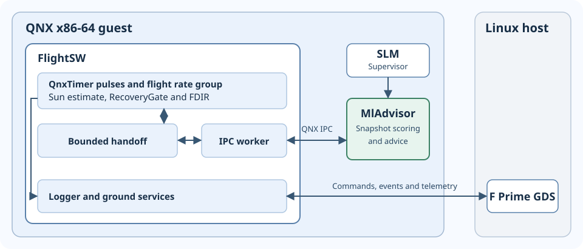

# Architecture

The reusable [`FprimeQnx` library](../../FprimeQnx) registers the QNX toolchains, platform selection, timer and native IPC driver. The [Ref patch](../../adoption/ref-qnx.patch) shows how an existing F Prime deployment can use the library. The [ADCS project](../../FprimeQnxReference) supplies the mission simulation and fault harness.

## Runtime components

| Location | Responsibility |
| --- | --- |
| FlightSW main thread | `QnxTimer` receives timer pulses and drives the passive rate group. `FlightCycle` reads the simulated sensors, checks advice, runs independent FDIR and commits the estimate or a degraded output. [Flight topology](../../FprimeQnxReference/FlightDeployment/Top/topology.fpp) · [FlightCycle](../../FprimeQnxReference/Components/FlightCycle/FlightCycle.cpp) |
| FlightSW IPC worker | `HubLink` and `GenericHub` exchange snapshots and advice through `QnxMsgDriver`. Bounded single-producer, single-consumer queues separate IPC from the periodic work. [Main and worker](../../FprimeQnxReference/FlightDeployment/Main.cpp) · [Handoff](../../FprimeQnxReference/Components/Link/SpscQueue.hpp) |
| FlightSW ground path | The logger drains bounded records and calls `FlightGround`. Optional `CdhCore` and `ComCcsds` carry commands, events and telemetry over TCP, driven by a separate ground timer and active rate groups. [FlightGround](../../FprimeQnxReference/Components/FlightGround/FlightGround.cpp) · [Flight topology](../../FprimeQnxReference/FlightDeployment/Top/topology.fpp) |
| MlAdvisor | The second F Prime process requests snapshots and returns structured advice. The deterministic mode drives repeatable faults. The optional mlpack FFN scores a simulated sensor bias and can propose a limited action. [Advisor](../../FprimeQnxReference/MlDeployment/Main.cpp) · [FFN](../../FprimeQnxReference/MlDeployment/Ffn.cpp) |
| QNX supervisor | The [SLM template](../../FprimeQnxReference/qnx/m3-slm.xml.in) starts FlightSW, waits for its named channel, then starts the advisor. SLM manages advisor restarts when repair is enabled. |
| Linux host | F Prime GDS displays ADCS application events and channels. Local test scripts launch the QNX guest, collect evidence and run the corresponding checkers. [Ground check](../../scripts/gds-check.sh) · [Reproduction](reproduce.md) |

## Engineering decisions

1. **Use the existing Ref deployment to validate adoption.** Its mission components, ordinary command sequencer and GDS remain available through a small port patch. ADCS is a separate reference deployment for testing the failure boundary. [Adoption](adopt.md)
2. **Keep periodic estimation independent of the advisor.** The flight path exchanges data with fixed-capacity queues. A full queue can drop a snapshot. The IPC worker owns serialization and QNX request/reply. [Flight cycle and handoff](../../FprimeQnxReference/Components/FlightCycle/FlightCycle.cpp)
3. **Keep F Prime's in-process queues asynchronous.** The platform uses the framework's queue implementations for in-process work. QNX `MsgSend` provides synchronous request/reply across the process boundary. [Platform selection](../../FprimeQnx/cmake/platform/QNX.cmake) · [Native driver](../../FprimeQnx/Drv/QnxMsgDriver/QnxMsgDriver.cpp)
4. **Use explicit scheduling and dedicated timers.** FlightSW requests `SCHED_FIFO` and drives the flight rate group from a private timer channel. Ground rate groups use their own timer and task priorities. QNX 8.0 discontinued the adaptive partitioning scheduler (APS). [Flight initialization](../../FprimeQnxReference/FlightDeployment/Main.cpp) · [QNX discontinuation notice](https://qnx.com/developers/docs/relnotes8.0/com.qnx.doc.discontinuation_notice/topic/general.html)
5. **Keep control authority in FlightSW.** The advisor can propose one sensor-exclusion action. The Gate checks geometry and independent evidence, and the estimator can signal degraded output. Spacecraft-wide safe mode remains outside this interface. [Recovery logic](../../FprimeQnxReference/Components/FlightCycle/Recovery.hpp)
6. **Validate the session before using a result.** SLM restores the advisor process. FlightSW admits advice only for a current session and an eligible issued snapshot. The first accepted result is the application rejoin point. [Protocol](../../FprimeQnxReference/Components/Link/Protocol.cpp) · [Flight cycle](../../FprimeQnxReference/Components/FlightCycle/FlightCycle.cpp)
7. **Hold the fault inputs fixed across repair policies.** The Q1/Q2 harness uses the same guest, code, model, seed and injection rule. The SLM XML check allows the advisor repair field to vary. [Paired runner](../../scripts/m4-check.sh) · [SLM template](../../FprimeQnxReference/qnx/m3-slm.xml.in)
8. **Publish ground events from the logger.** FlightSW transfers records out of the periodic path before emitting F Prime events and telemetry. Ground services share the FlightSW process and use dedicated execution paths within it. [Ground component](../../FprimeQnxReference/Components/FlightGround/FlightGround.cpp) · [GDS options](reproduce.md#adcs-ground-system)
9. **Check every planned release.** The fault verifier checks the schedule and the application behavior from per-run evidence. Treat the configured deadline as an acceptance rule for the recorded environment. [Case verifier](../../FprimeQnxReference/test/int/check-m3.py) · [Timing scope](limitations.md)

## RecoveryGate rules

| Rule | Meaning in the current deployment |
| --- | --- |
| R1 | Permit no action or a valid sun-sensor exclusion. Reject unknown action values and invalid channels. |
| R2 | Require valid format, current session, fresh data and a matching issued snapshot. Discard stale, duplicate, unissued or revoked-session advice. |
| R3 | Require a persistent candidate before using advisor-proposed exclusion. Independent FDIR tracks its own candidate persistence. |
| R4 | Limit how frequently isolation actions can be approved. |
| R5 | Require observable sensor geometry after a proposed exclusion. |
| R6 | Require consistency of the remaining sensors and an independent residual confirming the implicated sensor. |
| R7 | Unassigned in the current verifier. |
| R8 | Suppress advisor use after repeated invalid results and allow FlightSW to continue with FDIR. |
| R9 | Unassigned in the current verifier. |

[Gate implementation](../../FprimeQnxReference/Components/FlightCycle/Recovery.hpp) · [Session and rejection handling](../../FprimeQnxReference/Components/FlightCycle/FlightCycle.cpp) · [Host Gate tests](../../FprimeQnxReference/test/int/recovery-policy.cpp)

## Advisor lifecycle

FlightSW issues a session and tracks the snapshots it hands to that advisor. In normal operation it can accept eligible advice after checking the protocol and Gate. If advice expires or the session changes, FlightSW falls back to its own FDIR and continues producing its estimate or a degraded state. When SLM restarts the advisor, the next handshake establishes a new session. An eligible result from that session restores advisor use. Results from a revoked session are rejected. [Restart behavior and checks](results.md#trained-advisor-and-offline-replay)
